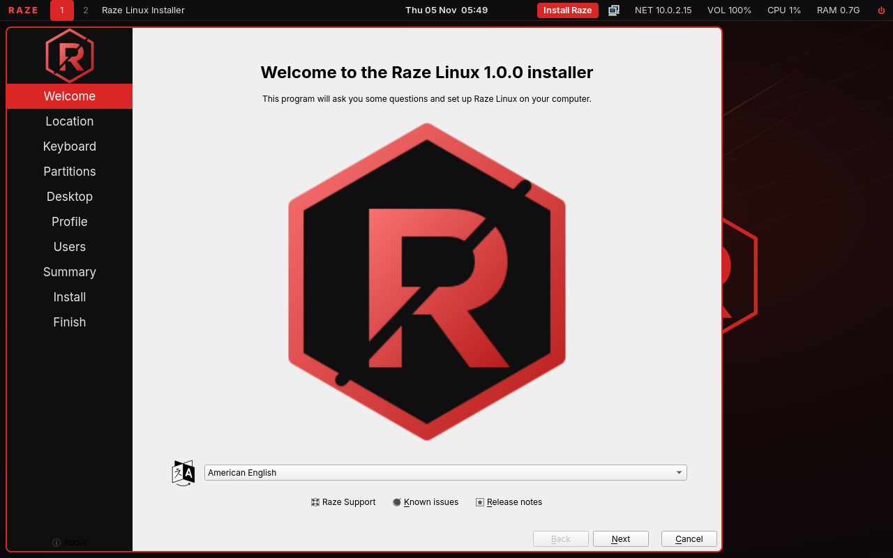
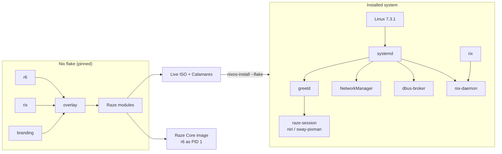

<div align="center">


# RAZE LINUX

### Rust-Powered. Performance-Driven. Minimal by Design.

Raze Linux is an experimental, performance-focused Linux distribution built around lightweight system services, reproducible package management, and a Rust-first development philosophy.

[](https://github.com/SwashX-dev/Raze-Linux/releases/download/v1.0.0/raze-linux-v1.0.0-x86_64.iso)

[](https://github.com/SwashX-dev/Raze-Linux/releases/tag/v1.0.0)


[](https://github.com/SwashX-dev/Raze-Linux/actions/workflows/rust-ci.yml)
[](https://github.com/SwashX-dev/Raze-Linux/actions/workflows/qemu-tests.yml)
[](LICENSE)

**[ISO](https://github.com/SwashX-dev/Raze-Linux/releases/download/v1.0.0/raze-linux-v1.0.0-x86_64.iso)** ·
**[SHA256SUMS](https://github.com/SwashX-dev/Raze-Linux/releases/download/v1.0.0/SHA256SUMS)** ·
**[Release notes](https://github.com/SwashX-dev/Raze-Linux/releases/tag/v1.0.0)** ·
**[Install guide](docs/installation/graphical.md)** ·
**[Source](https://github.com/SwashX-dev/Raze-Linux)**



<sub>Real screenshots from the 1.0.0 ISO in QEMU/KVM. More: [installer](docs/images/installer-desktop.png) · [installed desktop](docs/images/installed-checks.png) · [software-rendered fallback](docs/images/live-software-session.png)</sub>

</div>

---

## Overview

Raze Linux 1.0 is a **NixOS-derived distribution built with Nix**: the whole system
is declared in Nix, built reproducibly from a pinned nixpkgs revision, and installed
as atomic generations you can roll back from the boot menu. On top of that
foundation Raze ships its own Rust components, a performance-tuned default
configuration, a keyboard-first desktop, and a graphical installer.

**Why it exists:** to see how far a desktop Linux system can be pushed toward low
overhead and fast startup when every default is measured, and to develop
Rust-first core components (init, supervision, package tooling) with real tests and
real benchmarks instead of claims.

## Release status — v1.0.0

| | |
|---|---|
| Version | **1.0.0** (2026-11-05) |
| Architecture | x86_64 |
| Kernel | Linux **7.3.1** (latest stable at release) |
| Base | nixpkgs `1d060086d60c` (nixos-unstable, pinned) |
| Default desktop | **niri** + Raze session (software-rendered sway fallback without 3D GPU) |
| Default PID 1 | **systemd** (r6 runs as PID 1 in Raze Core and an optional boot entry) |
| Package management | **Rix** (Rust) on top of **Nix** |
| Privilege escalation | **sudo-rs** |
| Installer | **Calamares** with a Raze install module |

What is honestly *not* in 1.0: the Rift compositor, r6 as the default PID 1 of
installed systems, and a native Nix evaluator. See
[known limitations](#known-limitations).

## Features

- **r6** — Rust init + service supervisor (PID 1 verified in CI), single-process
  supervision of all services, dependency-ordered parallel activation, readiness
  notification, restart limits, rotated logs, build-time service-graph validation.
- **Rix** — Rust package-management CLI with native, Nix-compatible NAR hashing,
  store verification, generations and atomic rollback, and an instant search index;
  evaluation, builds and installs are delegated to Nix (and printed as such).
- **Reproducible and atomic** — pinned flake, system generations, rollbacks.
- **sudo-rs** by default, classic sudo disabled.
- **Lean defaults** — dbus-broker, zram swap, bounded journald, no
  speech-dispatcher, explicit small font set, no wait-online.
- **Desktop choice at install** — niri (default), Hyprland, dwl, Xfce, LXQt,
  KDE Plasma, GNOME, dwm; profiles Desktop, Development, Minimal.
- **Works without a 3D GPU** — `raze-session` detects software-only rendering and
  starts a themed sway/pixman session instead of a black screen.

## Architecture



Details: [docs/architecture/overview.md](docs/architecture/overview.md).

## r6 init system

| Binary | Role |
|---|---|
| `r6-init` | PID 1: mounts, reaping, supervisor respawn, emergency shell, ordered shutdown |
| `r6-supervise` | One event loop supervising every service (s6 uses one process per service) |
| `r6-activate` | Validates service graphs (cycles, unknown deps); prints parallel waves |
| `r6-log` | Rotated, timestamped logs |
| `r6` | `status`, `start`, `stop`, `restart`, `enable`, `disable`, `list`, `logs`, `reload`, `check`, `info`, `reboot`, `poweroff` |

```toml
# /etc/r6/services/sshd.toml
command = ["/run/current-system/sw/bin/sshd", "-D"]
depends = ["network"]
restart = "always"
enable = true
```

Tested by 14 unit + 18 end-to-end tests and a QEMU boot test where r6 is PID 1.
→ [docs/architecture/r6.md](docs/architecture/r6.md)

## Rix package manager

```bash
rix search firefox          # native index search
rix install firefox         # → nix profile add nixpkgs#firefox
rix list                    # native manifest reader
rix generations             # native
rix rollback                # native, atomic
sudo rix system switch      # → nixos-rebuild switch --flake /etc/nixos#raze
rix hash path ./dir         # native NAR hash, identical to `nix hash path`
rix verify /nix/store/…     # native re-hash vs the Nix database
```

Rix is a front-end, **not** a Nix reimplementation; what is native and what is
delegated is listed in [docs/architecture/rix.md](docs/architecture/rix.md).

## Rift compositor

Rift is **not included in 1.0** and the installer does not offer it. Its purpose
and release criteria are in [docs/architecture/rift.md](docs/architecture/rift.md).
The default compositor is upstream niri.

## Supported desktops

| Desktop | Status |
|---|---|
| **niri** (Raze Desktop, default) | Installed and tested; shipped on the ISO |
| sway + pixman (automatic fallback) | Tested (VM without 3D) |
| Hyprland, dwl, Xfce, LXQt, KDE Plasma, GNOME, dwm | Selectable; downloaded during install; **not tested in 1.0** |

## Installation

1. Download the [ISO](https://github.com/SwashX-dev/Raze-Linux/releases/download/v1.0.0/raze-linux-v1.0.0-x86_64.iso) and [SHA256SUMS](https://github.com/SwashX-dev/Raze-Linux/releases/download/v1.0.0/SHA256SUMS), then `sha256sum -c SHA256SUMS`.
2. Write it to a USB stick: `sudo dd if=raze-linux-v1.0.0-x86_64.iso of=/dev/sdX bs=4M status=progress oflag=sync`.
3. Boot it. The installer opens automatically: language → keyboard → disk → desktop → profile → user → install.
4. Reboot into Raze. **A network connection is required during installation.**

Full guide: [docs/installation/graphical.md](docs/installation/graphical.md) ·
manual install: [docs/installation/manual.md](docs/installation/manual.md) ·
recovery: [docs/installation/recovery.md](docs/installation/recovery.md)

## Hardware requirements

| | Minimum | Recommended |
|---|---|---|
| CPU | x86_64 | 2+ cores |
| RAM | 2 GB | 4 GB |
| Disk | 12 GB | 30 GB+ |
| Firmware | UEFI or BIOS (BIOS untested) | UEFI |
| GPU | any (software fallback) | OpenGL ES 3 capable for niri |

Tested: QEMU/KVM with OVMF (UEFI), virtio disk/network, with and without 3D
acceleration. Real hardware has not been tested for 1.0.

## Performance benchmarks

All numbers are real measurements; method and environment in
[docs/performance](docs/performance).

| Metric | Result | vs |
|---|---|---|
| Installed desktop boot → `graphical.target` | **4.75 s** (0.49 kernel + 2.15 initrd + 2.12 userspace) | — |
| Installed desktop memory after login (niri, waybar, terminal) | **525 MiB** | — |
| r6: PID 1 → 20 services started | **32.3 ms** | s6: 32.4 ms (same) |
| r6: init + supervision processes | **2** | s6: 27 |
| r6: supervision RSS / PSS | 1.78 MB / 1.77 MB | s6: 3.17 MB / **1.22 MB** |
| Raze Minimal kernel: kernel start → PID 1 | **169.6 ms** | generic: 201.4 ms (−16 %) |
| Raze Minimal kernel: system memory used | **34.9 MB** | generic: 50.2 MB (−30 %) |
| `rix search firefox` (113 419 packages) | **63.7 ms** | `nix search` warm: 1734 ms (27× faster) |
| ISO size | **2.11 GB** | first build: 3.08 GB |

Environment: QEMU/KVM on an AMD Ryzen 5 7235HS host (4 vCPU / 4 GiB for desktop
tests, 2 vCPU / 256 MiB for Raze Core), medians of 10 boots where applicable.
s6 wins on PSS; r6 is not faster than s6 at activation, it matches it with fewer
processes. Full tables: [docs/performance/benchmarks.md](docs/performance/benchmarks.md).

## Build from source

```bash
git clone https://github.com/SwashX-dev/Raze-Linux && cd Raze-Linux
nix build .#iso                       # → result/iso/raze-linux-v1.0.0-x86_64.iso
nix build .#checks.x86_64-linux.core-boot .#checks.x86_64-linux.desktop
nix develop -c cargo test --workspace
```

Requires Nix with flakes, ~40 GB free disk for the ISO, KVM for VM tests.
→ [docs/development/building.md](docs/development/building.md)

## Contributing

Issues and pull requests are welcome — see [CONTRIBUTING.md](CONTRIBUTING.md).
Performance claims need measurements; delegated functionality must be labelled.

## Known limitations

- Default PID 1 on installed systems is **systemd**; the r6 boot entry is
  experimental and not boot-tested in 1.0.
- **Rift is not included**; niri is the default compositor.
- **Rix delegates** evaluation, builds, substitution and installs to Nix.
- Installation requires a network connection.
- niri requires a 3D-capable GPU; elsewhere the sway/pixman fallback is used
  (no xdg-desktop-portal in that session).
- Not tested: BIOS installs, manual partitioning, dual boot, non-default desktops,
  real hardware, non-generic kernel profiles on installed systems.
- The ISO is not signed (SHA-256 checksums only).

Full list: [docs/troubleshooting/known-issues.md](docs/troubleshooting/known-issues.md)

## Development roadmap

1. r6 as default PID 1 for the Minimal profile; boot-test the r6 entry in CI.
2. Rift: Smithay compositor with DRM/libinput backend, GLES **and** pixman renderers.
3. Rix: native substitution (narinfo + parallel NAR downloads), then evaluation.
4. Hardware validation matrix (real machines, BIOS, dual boot), signed releases.
5. Desktop memory and boot-time reductions, measured per change.

## License

Raze Linux's own code is MIT licensed ([LICENSE](LICENSE)). The ISO contains
third-party software (Linux, nixpkgs packages, Calamares, niri, sudo-rs, …) under
their own licenses.

## Credits

Built on the work of the [NixOS/nixpkgs](https://github.com/NixOS/nixpkgs)
community, the [Linux kernel](https://kernel.org), [niri](https://github.com/YaLTeR/niri),
[Smithay](https://github.com/Smithay/smithay), [sway/wlroots](https://swaywm.org),
[Calamares](https://calamares.io), [sudo-rs](https://github.com/trifectatechfoundation/sudo-rs)
(Trifecta Tech Foundation), [s6](https://skarnet.org/software/s6/) (the inspiration
for r6), waybar, fuzzel, foot, mako and busybox.
