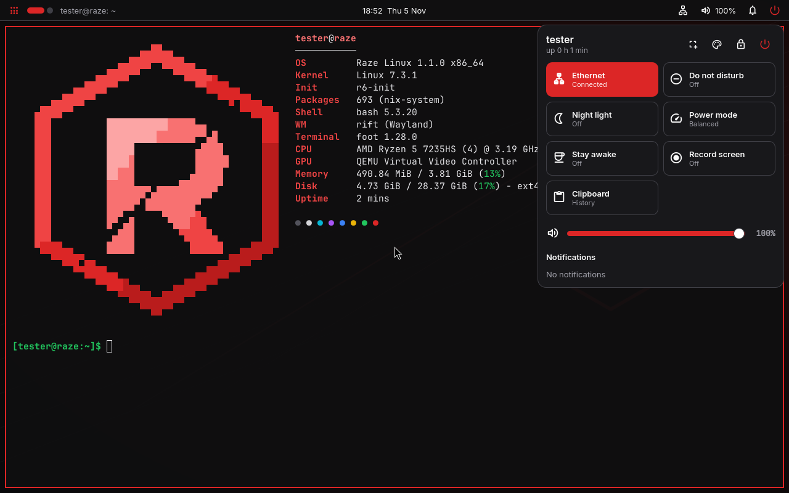
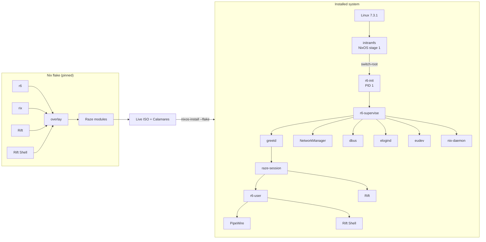

<div align="center">


# RAZE LINUX

### Rust-Powered. Performance-Driven. Minimal by Design.

Raze Linux is an experimental, performance-focused Linux distribution built around lightweight system services, reproducible package management, and a Rust-first development philosophy: its own init system (r6), its own Wayland compositor (Rift) and desktop shell, on a reproducible Nix base.

[](https://github.com/SwashX-dev/Raze-Linux/releases/download/v1.1.0/raze-linux-v1.1.0-x86_64.iso)

[](https://github.com/SwashX-dev/Raze-Linux/releases/tag/v1.1.0)


[](https://github.com/SwashX-dev/Raze-Linux/actions/workflows/rust-ci.yml)
[](https://github.com/SwashX-dev/Raze-Linux/actions/workflows/qemu-tests.yml)
[](LICENSE)

**[ISO](https://github.com/SwashX-dev/Raze-Linux/releases/download/v1.1.0/raze-linux-v1.1.0-x86_64.iso)** ·
**[SHA256SUMS](https://github.com/SwashX-dev/Raze-Linux/releases/download/v1.1.0/SHA256SUMS)** ·
**[Release notes](https://github.com/SwashX-dev/Raze-Linux/releases/tag/v1.1.0)** ·
**[Install guide](docs/installation/graphical.md)** ·
**[Source](https://github.com/SwashX-dev/Raze-Linux)**



<sub>Real screenshots of the 1.1.0 release in QEMU/KVM (no 3D acceleration). More: [live session with the installer](docs/images/rift-live-installer.png) · [launcher](docs/images/rift-launcher.png) · [installer dialog](docs/images/rift-installer-dialog.png)</sub>

</div>

---

## Overview

Raze Linux is a **NixOS-derived distribution built with Nix**: the whole system is
declared in Nix, built reproducibly from a pinned nixpkgs revision, and installed as
atomic generations you can roll back from the boot menu. On that foundation Raze runs
its own Rust components: **r6** as PID 1 and service manager, the **Rift** Wayland
compositor with **Rift Shell**, and the **Rix** package tool.

**Why it exists:** to see how far a desktop Linux system can be pushed toward low
overhead and fast startup when every default is measured, and to build Rust-first
core components (init, supervision, compositor, package tooling) with real tests and
real benchmarks instead of claims.

## Release status — v1.1.0

| | |
|---|---|
| Version | **1.1.0** (2026-11-05) |
| Architecture | x86_64 |
| Kernel | Linux **7.3.1**; installer default profile: **performance** |
| Base | nixpkgs `1d060086d60c` (nixos-unstable, pinned) |
| PID 1 / service manager | **r6** — live ISO, installed systems, default desktop (systemd only inside the initramfs) |
| Default desktop | **Rift** (Raze's own Smithay compositor) + **Rift Shell** |
| Package management | **Rix** (Rust) on top of **Nix** |
| Privilege escalation | **sudo-rs** |
| Installer | **Calamares** with a Raze install module, GRUB on BIOS and EFI |

Upgrading from 1.0: [docs/installation/upgrade.md](docs/installation/upgrade.md).
What is not done yet: [known limitations](#known-limitations).

## Features

- **r6 everywhere** — Rust PID 1 and supervisor for the whole system and, with
  `r6-user`, for each desktop session (D-Bus, PipeWire, Rift Shell, clipboard
  history). systemd's roles are covered by r6, eudev, elogind, dbus-daemon, ntpd-rs,
  `r6-tmpfiles` and `r6-syslogd`; `nixos-rebuild switch` works through r6's own
  switch-to-configuration.
- **Rift** — scrollable-tiling Wayland compositor written on Smithay: columns that
  never resize each other, dynamic workspaces per monitor, animations, GLES on GPUs
  and a pixman renderer when there is no 3D acceleration, screencopy for screenshots
  and recording, XWayland, JSON IPC.
- **Rift Shell** — panel, launcher (apps, calculator, commands), control centre
  (Wi-Fi, Bluetooth, audio, brightness, power profiles, night light, Do Not Disturb),
  notification daemon with history, lock screen, power menu, screenshots, screen
  recording, clipboard history, OSD, polkit agent, themes, plugins, multi-monitor.
- **Rix** — Rust package-management CLI with native, Nix-compatible NAR hashing,
  store verification, generations and atomic rollback, instant search; evaluation,
  builds and installs are delegated to Nix (and printed as such).
- **sudo-rs** is the only sudo. **fastfetch** knows Raze (`neofetch` runs it too).
- **Reproducible and atomic** — pinned flake, system generations, rollbacks.
- **Desktop choice at install** — Rift (default), niri, Hyprland, dwl, Xfce, LXQt,
  KDE Plasma, GNOME, dwm.

## Architecture



Details: [docs/architecture/overview.md](docs/architecture/overview.md) ·
[r6](docs/architecture/r6.md) · [Rift](docs/architecture/rift.md) ·
[Rift Shell](docs/architecture/rift-shell.md) · [Rix](docs/architecture/rix.md)

## r6 init system

| Binary | Role |
|---|---|
| `r6-init` | PID 1: mounts, reaping, supervisor respawn, emergency shell, ordered shutdown |
| `r6-supervise` | One event loop supervising every service (s6 uses one process per service) |
| `r6-user` | The same supervisor for a user session |
| `r6-tmpfiles`, `r6-syslogd` | tmpfiles.d and `/dev/log` |
| `r6-activate`, `r6-config` | Service-graph validation (build time), inspection |
| `r6` | `status`, `start`, `stop`, `restart`, `enable`, `disable`, `list`, `logs`, `reload`, `check`, `info`, `reboot`, `poweroff`, `suspend` |

Services are declared in Nix and rendered to TOML:

```nix
raze.r6.services.ntpd-rs = {
  command = [ "${pkgs.ntpd-rs}/bin/ntp-daemon" "-c" "/etc/ntpd-rs.toml" ];
  user = "ntpd-rs";
  capabilities = [ "CAP_SYS_TIME" "CAP_NET_BIND_SERVICE" ];
  restart = "always";
};
```

```bash
r6 status                 # every service, state, uptime
r6 logs NetworkManager    # rotated per-service logs
r6 --user status          # the session's services
```

## Rift and Rift Shell

```bash
rift msg workspaces                   # IPC (JSON)
rift msg action workspace 2
rift-shell screenshot region          # ~/Pictures/Screenshots + clipboard
rift-shell record toggle              # ~/Videos/Recordings
```

Default keys: Super+Return terminal · Super+D launcher · Super+N control centre ·
Super+V clipboard · Super+Escape power menu · Super+Alt+L lock · Print screenshot ·
Super+←/→ focus column · Super+Ctrl+←/→ move column · Super+R width preset ·
Super+F maximize · Super+1…5 workspace · Super+Shift+E log out. Configuration:
`~/.config/rift/config.toml` (defaults: [rift/default-config.toml](rift/default-config.toml)),
`~/.config/rift-shell/settings.json`.

## Rix package manager

```bash
rix search firefox          # native index search
rix install firefox         # → nix profile add nixpkgs#firefox
rix generations             # native
rix rollback                # native, atomic
sudo rix system switch      # → nixos-rebuild switch --flake /etc/nixos#raze (works under r6)
rix hash path ./dir         # native NAR hash, identical to `nix hash path`
```

Rix is a front-end, **not** a Nix reimplementation; what is native and what is
delegated is listed in [docs/architecture/rix.md](docs/architecture/rix.md).

## Supported desktops

| Desktop | Status in 1.1 |
|---|---|
| **Rift + Rift Shell** (default) | Shipped on the ISO; tested with and without 3D acceleration, under r6 and systemd |
| niri + waybar session | Tested under r6 with 3D acceleration (benchmark VM) |
| sway + pixman (niri's automatic fallback) | Tested in 1.0 |
| Hyprland, dwl, Xfce, LXQt, KDE Plasma, GNOME, dwm | Selectable; downloaded during install; **not tested in 1.1** |

## Installation

1. Download the [ISO](https://github.com/SwashX-dev/Raze-Linux/releases/download/v1.1.0/raze-linux-v1.1.0-x86_64.iso) and [SHA256SUMS](https://github.com/SwashX-dev/Raze-Linux/releases/download/v1.1.0/SHA256SUMS), then `sha256sum -c SHA256SUMS`.
2. Write it to a USB stick: `sudo dd if=raze-linux-v1.1.0-x86_64.iso of=/dev/sdX bs=4M status=progress oflag=sync`.
3. Boot it. The installer opens automatically: language → keyboard → disk → desktop → profile → user → install.
4. Reboot into Raze. **A network connection is required during installation.**

Full guide: [docs/installation/graphical.md](docs/installation/graphical.md) ·
upgrade from 1.0: [docs/installation/upgrade.md](docs/installation/upgrade.md) ·
manual install: [docs/installation/manual.md](docs/installation/manual.md) ·
recovery: [docs/installation/recovery.md](docs/installation/recovery.md)

## Hardware requirements

| | Minimum | Recommended |
|---|---|---|
| CPU | x86_64 | 2+ cores |
| RAM | 2 GB | 4 GB |
| Disk | 12 GB | 30 GB+ |
| Firmware | UEFI or BIOS (BIOS untested) | UEFI |
| GPU | any (Rift renders with pixman without 3D) | OpenGL ES 3 capable |

Tested: QEMU/KVM with OVMF (UEFI), virtio disk/network, with and without 3D
acceleration. Real hardware has not been tested for 1.1.

## Performance benchmarks

All numbers are real measurements; method and environment in
[docs/performance](docs/performance).

| Metric | Raze 1.1 | Compared with |
|---|---|---|
| Desktop boot: kernel start → login screen | **5.08 s** (r6) | systemd, same system: 6.41 s |
| Desktop memory used at the login screen | **355 MB** (r6) | systemd: 379 MB |
| Userspace memory at the login screen (PSS) | 93.5 MB (r6) | systemd: **73.0 MB** (socket-activated nix-daemon) |
| PID 1 memory (RSS) | **2.6 MB** (r6-init) | systemd: 15.0 MB |
| r6: PID 1 → 20 services started (Raze Core) | 32.9 ms | s6: **31.6 ms** (equal within noise) |
| r6: init + supervision processes | **2** | s6: 27 |
| Compositor CPU at idle, per minute | **0.00 s** (Rift) | niri: 0.05 s |
| Compositor CPU, terminal updating 20×/s, per 10 s | 0.48 s (Rift) | niri: 0.50 s |
| Desktop session memory (PSS), one terminal open | **217 MB** (Rift + Rift Shell) | niri + waybar session: 244 MB |
| `rix search firefox` (113 419 packages) | **63.7 ms** | `nix search` warm: 1734 ms |
| ISO size | **2.09 GB** (1.95 GiB) | 1.0.0: 2.11 GB |

QEMU/KVM on an AMD Ryzen 5 7235HS host; desktop boots: 4 vCPU / 3 GiB, no 3D, 5
interleaved boots; compositors: virgl GPU, 3 interleaved runs; Raze Core: 2 vCPU /
256 MiB, 10 boots. Where Raze loses (systemd's lower userspace PSS, s6's lower PSS),
the table says so.

Full tables and raw data: [docs/performance/benchmarks.md](docs/performance/benchmarks.md).

## Build from source

```bash
git clone https://github.com/SwashX-dev/Raze-Linux && cd Raze-Linux
nix build .#iso                       # → result/iso/raze-linux-v1.1.0-x86_64.iso
nix build .#checks.x86_64-linux.desktop .#checks.x86_64-linux.core-boot
nix develop -c cargo test --workspace
nix develop -c cargo test --manifest-path rift/Cargo.toml
```

Requires Nix with flakes, ~40 GB free disk for the ISO, KVM for VM tests.
→ [docs/development/building.md](docs/development/building.md)

## Contributing

Issues and pull requests are welcome — see [CONTRIBUTING.md](CONTRIBUTING.md).
Performance claims need measurements; delegated functionality must be labelled.

## Known limitations

- **systemd runs inside the initramfs** (NixOS stage 1); PID 1 is r6 from
  switch-root on. Some nixpkgs libraries still link `libsystemd`.
- **r6 has no socket activation or timer units yet**; NixOS services without an r6
  equivalent do not run (the system build warns and names them).
- **Rift**: single GPU, shm-only screencopy (no wl-screenrec, no portal screen
  sharing), no touch gestures or tablet input.
- **Rix delegates** evaluation, builds, substitution and installs to Nix.
- Installation and upgrades need a network connection; upgrading from 1.0 compiles
  Raze's own packages locally (2–4 minutes in a 4-vCPU VM).
- Not tested: BIOS installs, manual partitioning, dual boot, desktops other than Rift
  and niri, real hardware.
- The ISO is not signed (SHA-256 checksums only).

Full list: [docs/troubleshooting/known-issues.md](docs/troubleshooting/known-issues.md)

## Development roadmap

1. Rift: multi-GPU, dmabuf screencopy, touch gestures, tablet input.
2. r6: replace the systemd-based initramfs with an r6 stage 1.
3. Rix: native substitution (narinfo + parallel NAR downloads), then evaluation.
4. Hardware validation matrix (real machines, BIOS, dual boot), signed releases.
5. Desktop memory and boot-time reductions, measured per change.

## License

Raze Linux's own code is MIT licensed ([LICENSE](LICENSE)). The ISO contains
third-party software (Linux, nixpkgs packages, Calamares, Quickshell, sudo-rs, …) under
their own licenses.

## Credits

Built on the work of the [NixOS/nixpkgs](https://github.com/NixOS/nixpkgs)
community, the [Linux kernel](https://kernel.org), [niri](https://github.com/YaLTeR/niri),
[Smithay](https://github.com/Smithay/smithay) (Rift is built on it), [Quickshell](https://quickshell.org) and
[Noctalia](https://github.com/noctalia-dev/noctalia-shell) (Rift Shell's runtime and inspiration), [sway/wlroots](https://swaywm.org),
[Calamares](https://calamares.io), [sudo-rs](https://github.com/trifectatechfoundation/sudo-rs)
(Trifecta Tech Foundation), [s6](https://skarnet.org/software/s6/) (the inspiration
for r6), eudev, elogind, ntpd-rs, fastfetch, waybar, fuzzel, foot, mako and busybox.
