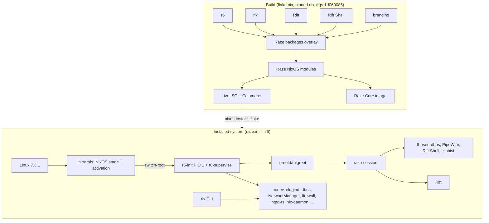

# Architecture overview

Raze Linux is a **NixOS-derived distribution built with Nix**: the system is
declared in Nix, built reproducibly from a pinned nixpkgs revision, and installed as
an atomic, roll-back-able generation. Raze adds its own Rust components (r6, Rift,
Rix, the rift-shell helper), a Raze module set (`raze.*` options), Rift Shell,
branding, a Calamares installer and a performance-focused default configuration.

## Why NixOS-derived

Re-implementing NixOS's module system, activation and hardware/desktop integration
would consume whole releases without producing a usable system. Building on nixpkgs
gives Raze a pinned, reproducible package set (>120 000 packages), binary caches,
atomic upgrades, generations and rollbacks, while Raze's own components replace the
parts it cares about: since 1.1, the init system and service manager, the
compositor and the desktop shell.

## Components and their status in 1.1

| Component | Status | Notes |
|---|---|---|
| Linux kernel | Upstream **7.3.1** | Profiles: performance (installer default), generic, legacy (6.18 LTS), minimal (custom config). See [kernel.md](kernel.md). |
| **r6** init/supervisor | Default PID 1 everywhere | Live ISO, installed systems, user sessions (`r6-user`). systemd runs only in the initramfs. See [r6.md](r6.md). |
| **Rift** compositor | Default desktop | Smithay-based scrollable tiling; GLES or pixman. See [rift.md](rift.md). |
| **Rift Shell** | Default shell | Quickshell (QML) + `rift-shell` helper. See [rift-shell.md](rift-shell.md). |
| **Rix** package manager | Rust front-end | Native: search index, NAR hashing, store verification, generations/rollback. **Delegated to Nix**: evaluation, builds, substitution, installs. See [rix.md](rix.md). |
| Other desktops | Selectable at install | niri (+ waybar session), Hyprland, dwl, Xfce, LXQt, Plasma, GNOME, dwm. |
| Installer | Calamares + Raze job module | Generates a flake-based `/etc/nixos`; GRUB on BIOS and EFI. |
| Privilege escalation | **sudo-rs** | Classic sudo is disabled. |

## Repository layout

| Path | Contents |
|---|---|
| `r6/` | r6 crate: `r6-init`, `r6-supervise`, `r6-user`, `r6`, `r6-activate`, `r6-config`, `r6-log`, `r6-tmpfiles`, `r6-syslogd` |
| `rift/` | Rift compositor (own Cargo workspace; Smithay pinned by git revision) |
| `rift-shell/` | Rift Shell: `shell/` (QML), `src/` (the `rift-shell` helper) |
| `rix/` | Rix crate |
| `distro/modules/` | Raze NixOS modules (`raze.*` options); `r6.nix` holds the r6 service set |
| `distro/branding/` | Artwork, fastfetch logo, session configs, session scripts |
| `distro/iso/`, `distro/configurations/` | Live ISO and reference installed system |
| `distro/core/` | Raze Core: busybox + r6 initramfs image, s6 comparison tree |
| `installer/calamares/` | Calamares settings, module configs, `raze` job module, branding |
| `kernel/` | Kernel profile definitions and the Raze Minimal config fragment |
| `tests/` | VM checks (`tests/vm`) and QEMU drivers (`tests/qemu`) |
| `benchmarks/` | Benchmark harnesses, VM variants and recorded results |
