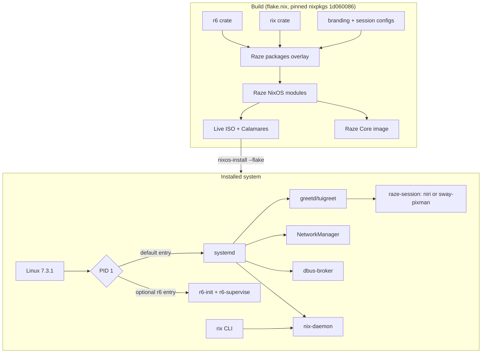

# Architecture overview

Raze Linux 1.0 is a **NixOS-derived distribution built with Nix**: the system is
declared in Nix, built reproducibly from a pinned nixpkgs revision, and installed
as an atomic, roll-back-able generation. Raze adds its own Rust components, a
Raze module set (`raze.*` options), branding, a Calamares installer and a
performance-focused default configuration.

## Why NixOS-derived for 1.0

The brief asked for an independent distribution "inspired by NixOS" and allowed a
temporary NixOS-derived foundation. Re-implementing NixOS's module system,
activation and the userspace integration of systemd-free desktops would have
consumed the entire first release without producing a usable system. Building on
nixpkgs gives Raze, on day one: a pinned and reproducible package set (>120 000
packages), binary caches, atomic upgrades and generations, rollbacks, and a
mature hardware/desktop integration — while Raze's own components are developed
and validated alongside.

## Components and their status in 1.0

| Component | Status | Notes |
|---|---|---|
| Linux kernel | Upstream **7.3.1** (latest stable at release time) | Profiles: generic, performance, legacy (6.18 LTS), minimal (custom config). See [kernel.md](kernel.md). |
| **r6** init/supervisor | Implemented, tested | Real PID 1 in **Raze Core**; optional r6 boot entry on installed systems. The default installed PID 1 is **systemd** (compatibility). See [r6.md](r6.md). |
| **Rix** package manager | Implemented as a Rust front-end | Native: search index, NAR hashing, store verification, generations/rollback, manifests, flake.lock. **Delegated to Nix**: evaluation, builds, substitution, installs. See [rix.md](rix.md). |
| **Rift** compositor | **Not implemented in 1.0** | Default desktop is **niri** (upstream). See [rift.md](rift.md). |
| Desktop session | niri + Raze session; sway (pixman) fallback | `raze-session` chooses at login. |
| Installer | Calamares + Raze job module | Generates a flake-based `/etc/nixos`. |
| Privilege escalation | **sudo-rs** | Classic sudo is disabled. |

## Repository layout

| Path | Contents |
|---|---|
| `r6/` | r6 crate: `r6-init`, `r6-supervise`, `r6-activate`, `r6-log`, `r6` |
| `rix/` | Rix crate |
| `distro/modules/` | Raze NixOS modules (`raze.*` options) |
| `distro/branding/` | Artwork, session configs (niri, sway, waybar, fuzzel, foot, mako), session scripts |
| `distro/iso/`, `distro/configurations/` | Live ISO and reference installed system |
| `distro/core/` | Raze Core: busybox + r6 initramfs image, s6 comparison tree |
| `installer/calamares/` | Calamares settings, module configs, `raze` job module, branding |
| `kernel/` | Kernel profile definitions and the Raze Minimal config fragment |
| `tests/` | VM checks (`tests/vm`) and QEMU drivers for installer testing (`tests/qemu`) |
| `benchmarks/` | Benchmark harnesses and recorded results |
